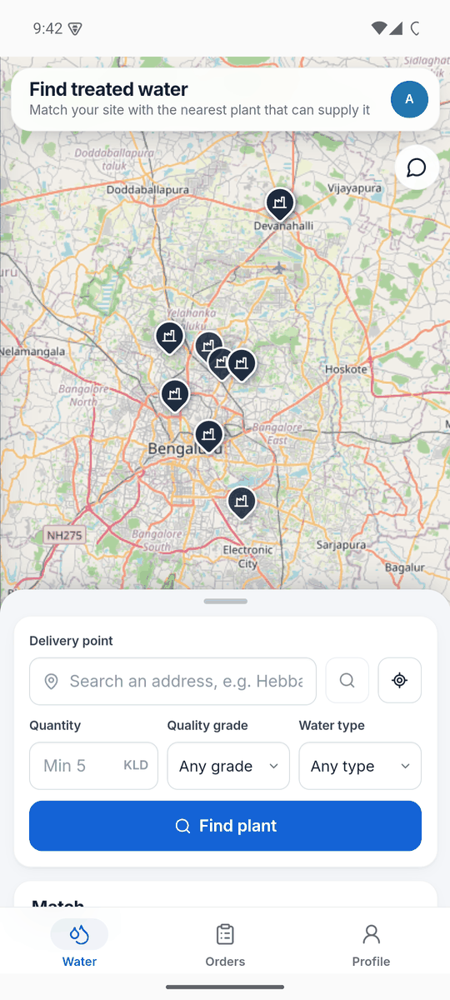
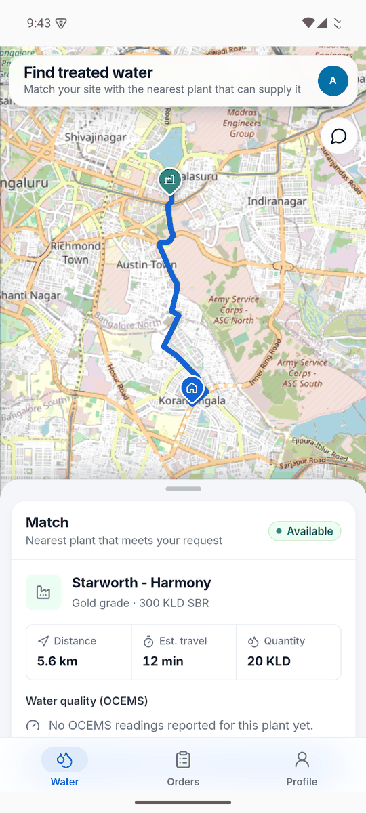
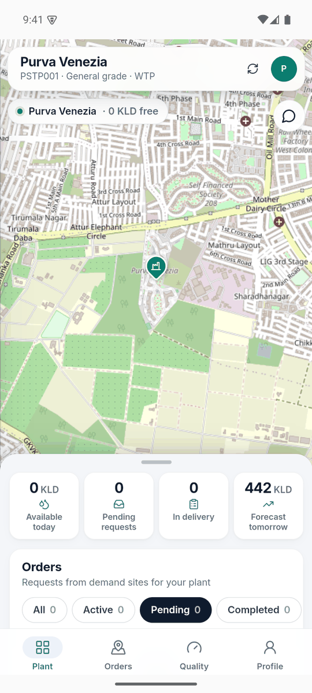
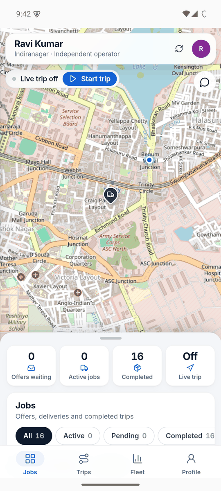
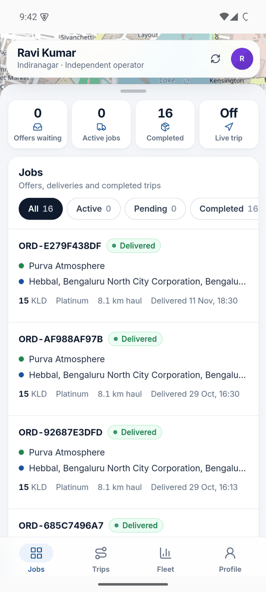
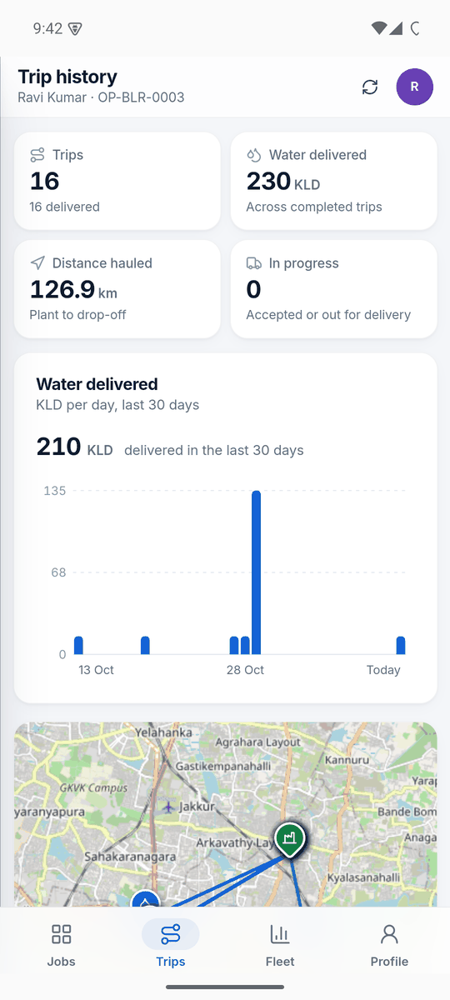

# ReFlow

**Treated wastewater, routed where it's needed.**

ReFlow connects sewage treatment plants (STPs) in Bengaluru with the people who can reuse their treated water, and coordinates the tankers that carry it there.

Treated water is a valuable resource, yet most of it goes unused. Buyers rarely know which plant is nearby, whether its water meets quality standards, or how to get it delivered. Plants have spare capacity but no simple way to sell it. ReFlow brings both sides, and the delivery partners between them, onto one platform.

## Screenshots

<table>
  <tr>
    <td align="center"><br><sub>Buyer: find water</sub></td>
    <td align="center"><br><sub>Buyer: matched plant and route</sub></td>
    <td align="center"><br><sub>Plant dashboard</sub></td>
  </tr>
  <tr>
    <td align="center"><br><sub>Tanker: start a trip</sub></td>
    <td align="center"><br><sub>Tanker: jobs</sub></td>
    <td align="center"><br><sub>Tanker: trip history</sub></td>
  </tr>
</table>

<sub>Screenshots from the Android app.</sub>

## Who it's for

| Role | Who they are | What ReFlow gives them |
|---|---|---|
| **Demand sites** | Construction sites, apartments, industry, landscaping | Find the nearest plant that has the right water, check its live quality readings, order, track the tanker and pay |
| **Plant operators (STPs)** | Treatment plant teams | Receive and accept orders, set prices, publish quality data, see demand forecasts, transfer water to other plants |
| **Tanker partners** | Independent and contracted delivery operators | Get job offers nearby, navigate each trip, share live location, manage their fleet and documents |
| **Admins** | Platform staff | Approve plants, tankers and quality reports, and watch demand across the city |

## How it works

1. **A buyer asks for water.** They set a delivery point (address, current location or a pin on the map), a quantity and a quality grade. ReFlow finds the nearest plant that can supply it and shows the road route, travel time and the plant's latest quality readings.
2. **The plant accepts.** The plant operator reviews the order and accepts or rejects it.
3. **A tanker is assigned.** The job is offered to nearby tanker partners one at a time, each with a short time to respond.
4. **The tanker delivers.** The driver taps **Start trip**. Google Maps opens with directions to the plant, then on to the buyer after pickup. Meanwhile the buyer follows the tanker live.
5. **The buyer pays.** A tax invoice (CGST + SGST) is issued, payable online or as cash on delivery. The trip is added to the tanker's history.

Plants can also request water from each other, using the same tanker assignment flow.

## Features

### For demand sites
- Search by address, current location or map pin, with a minimum order of 5 KLD.
- A match card shows the best plant, alternative routes, distance, ETA and OCEMS quality readings.
- Order list with All / Active / Pending / Completed filters, live tracking and shareable tracking links.
- Tax invoices with an order timeline, print/PDF export, and pay-now or cash on delivery.

### For plant operators
- A map of the plant's orders. Opening an order draws its delivery route.
- Daily capacity, pending requests, deliveries in progress and a 7-day demand forecast.
- Pricing control: base rate, peak-hour surcharge and off-peak discount.
- Quality reporting through OCEMS (online effluent monitoring) uploads, checked against CPCB limits.
- Plant-to-plant water transfers.

### For tanker partners
- A live job board: offers with expiry countdowns, refreshed automatically.
- A **Current job** card showing where to go next, the load, distance and drive time, and a one-tap call to the buyer.
- **Google Maps navigation** to the pickup plant and then the drop-off, with live location sharing for the buyer.
- Trip history with delivered-volume charts and a map of past routes.
- Fleet and compliance documents (RC, insurance, PUC, permit) for each vehicle.
- Step-by-step registration for independent and contracted operators, with a status lookup.

### For admins
- Overview, plants, approvals and orders in one dashboard.
- A city-wide order-density heat map with plant locations.
- Approval of plant and tanker registrations and OCEMS quality reports.

### Across the platform
- **Juno**, a chat assistant that finds plants and answers questions in plain language.
- **Demand forecasting** with a trained XGBoost model for each plant.
- **Android app** with native GPS, an app-style phone layout, a bottom tab bar, a full-screen map and a draggable bottom sheet.

## Android app

The Android app (`mobile/`) is a Capacitor shell around the web app. Pages load from the ReFlow server, so web updates reach the app without a new release. GPS runs through the native location service, so live tracking and "use my location" work reliably on phones. See [`mobile/README.md`](mobile/README.md) to build it.

## Tech stack

| Layer | Technology |
|---|---|
| Backend | Python, Flask, Gunicorn |
| Authentication | Supabase |
| Storage | PostgreSQL (via SQLAlchemy), with CSV/JSON files as a fallback for local use |
| Web frontend | React 19, TypeScript, Vite, React Router, React-Leaflet, lucide icons |
| Maps and routing | OpenStreetMap, Leaflet, OSRM road routing, OSMnx / NetworkX |
| Forecasting | XGBoost, scikit-learn, pandas, NumPy |
| Assistant | A local LLM through Ollama (`llama3.2:3b`), with RapidFuzz fuzzy matching |
| Mobile | Capacitor 8 (Android) |

## Project structure

```
app.py          Flask application: pages, business logic and JSON APIs
config.py       Settings read from environment variables
store.py        PostgreSQL storage layer
frontend/       React web app (builds into static/app/)
templates/      Server-rendered pages (login, signup, tracking, invoice, admin)
static/         Shared styles, brand assets and the built web app
mobile/         Android app (Capacitor)
ml/             Demand forecasting: dataset, training and prediction
chatbot/        Juno: fuzzy matcher and LLM gateway
data/           Plant master data, pricing and synthetic demand
scripts/        Utility scripts (data migration, synthetic data, routing)
supabase/       SQL migrations for Supabase
```

## Running locally

**Requirements:** Python 3.10+, Node.js 18+ (only to change the web frontend), and a Supabase project. Ollama is optional, for Juno's language model.

```bash
# Backend
python -m venv venv
source venv/bin/activate
pip install -r requirements.txt
python app.py                 # http://localhost:10000

# Web frontend (optional, for development)
cd frontend
npm install
npm run dev                   # http://localhost:5173, talks to Flask on :10000
npm run build                 # production build into static/app/
```

The server reads its settings from environment variables (or a `.env` file):

| Variable | Required | Purpose |
|---|---|---|
| `FLASK_SECRET_KEY` | Yes | Signs session cookies |
| `SUPABASE_URL`, `SUPABASE_KEY` | Yes | Supabase project for sign-in |
| `DATABASE_URL` | No | PostgreSQL connection. Without it, the app stores data in local files |
| `DATABASE_SCHEMA` | No | Schema for ReFlow's tables (default `reflow`) |
| `PORT` | No | Server port (default `10000`) |
| `OLLAMA_BASE_URL`, `JUNO_LLM_MODEL`, `JUNO_LLM_TIMEOUT` | No | Juno's language model settings |

To move existing local data into PostgreSQL, run `python scripts/migrate_to_postgres.py` once.

In production the app runs under Gunicorn (`gunicorn app:app --timeout 120`, see `Procfile`).

## Demand forecasting

Each plant has its own XGBoost model, trained on demand data for that plant. It predicts next-day and 7-day demand. Plant operators see the 7-day forecast on their dashboard and can plan capacity around it. Training and prediction code lives in `ml/`.

## Juno, the assistant

Juno is built into the dashboards. It handles everyday requests such as *"find me water near Jayanagar"* and general questions about the platform. Messages are first matched against known intents with fuzzy matching. Unclear messages go to a small local language model, which extracts the intent and any location. Juno keeps working on fuzzy matching alone if the model is unavailable.
